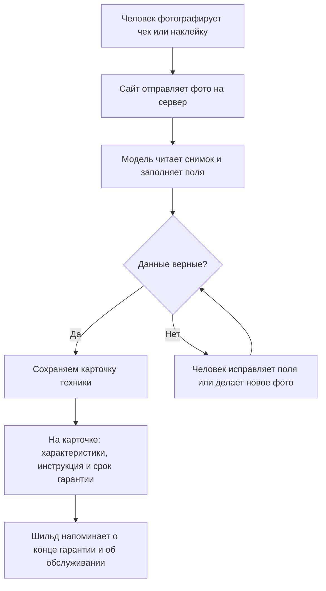

# Контекст чата: Шильд

Переписка от 6 ноября 2026. Она шла в другом окне Cursor, до того как этот репозиторий стал рабочей папкой. Здесь лежит текст той беседы и исходные документы.

Исходники:

- `docs/sources/я хочу реализовать веб приложение описанный в доку.md` — первый разбор идеи
- `docs/sources/проект.docx` и `docs/sources/проект.pdf` — документ продукта, по которому собирали демо

## На чём остановились

Продукт называется **Шильд**: сфотографировал чек или наклейку — получил паспорт техники. Интерфейс русский. Цвета: чёрный, оранжевый, светло-серый. MVP нужен для защиты: показать ценность, а не весь бизнес на год.

Стек, который защищаем:

- Next.js и TypeScript — экраны и сервер в одном проекте
- Vercel — хостинг, аккаунт уже есть
- Gemini Flash — бесплатное чтение фото, ключ из Google AI Studio
- Данные пока в браузере. Общий вход и Supabase — следующий шаг
- Google Vision не подключаем: модель сама читает снимок
- DeepSeek фото тоже читает, но официальный API платный по факту. В коде разъём сменный, сейчас стоит Gemini

Уже сделано в этом репозитории: главная, кабинет с учебными карточками, карточка устройства, добавление с кнопкой «Распознать» и тремя примерами без ключа. Чтобы читать настоящие фото, нужен `.env.local`:

```
GEMINI_API_KEY=ваш_ключ
GEMINI_MODEL=gemini-3.5-flash
```

Ключ берётся в Google AI Studio. После этого сервер нужно перезапустить.

---

## Вы

/Users/vladislavkoval/Downloads/я хочу реализовать веб приложение описанный в доку.md 
проанализируй тут контекст нашей идеи что я хочу реализовать мне нужно будет чтобы мы потом с тобой на версель закинули то что у нас вышло мне нужен рабочий мвп веб приложение 
с чего мне начать все ли тебе понятно давай порассуждаем

## Ответ

Идея понятна. Это не «распознай любую технику по одному красивому фото», а **личный паспорт техники**: устройства, серийники, чеки, инструкции, гарантия и напоминания. На Vercel это нормально выкладывается как рабочее веб-приложение.

Ниже — как я это вижу, где реальный MVP, и с чего лучше начать.

## Что вы хотите на самом деле

Главный сценарий такой:

1. Человек фотографирует технику, лучше шильдик.
2. Приложение вытаскивает бренд, модель, серийный номер.
3. Показывает описание, характеристики, инструкцию.
4. Человек прикладывает чек или дату покупки.
5. Считается срок гарантии, позже приходит напоминание.

Это уже продукт. Распознавание по фото — только вход в него, не вся суть.

Важная граница, без которой MVP развалится на обещании:

- **По фото можно** достать модель и серийник, если текст читается.
- **По одному общему виду нельзя** честно обещать точную модель и «гарантия действует».
- **Реальный статус гарантии** появляется только после даты покупки, срока и, лучше, чека.

Для демо это даже лучше: вы показываете не магию, а рабочий процесс.

## Что входит в рабочий MVP на Vercel

Я бы резал объём жёстко. Первая версия должна уметь одно законченное действие:

**сфотографировал наклейку → проверил поля → увидел карточку устройства с характеристиками и датой окончания гарантии.**

В MVP:

- регистрация / вход
- список моих устройств
- карточка устройства
- загрузка фото техники, шильдика и чека
- распознавание с экраном проверки
- небольшой каталог на 10–20 моделей: описание, характеристики, ссылка на инструкцию
- дата покупки + срок гарантии → дата окончания
- деплой на Vercel

В первую версию не надо:

- отдельный NestJS-сервер
- Google Vision, векторный поиск, своя нейросеть
- проверку гарантии через производителя
- маркетплейсы
- идеальное распознавание любой техники с трёх метров

Напоминания по почте можно сразу заложить в данные, а отправку писем оставить на следующий шаг. Для демо достаточно показать на карточке: «гарантия до 12 марта 2027, осталось 46 дней».

## Как это лучше собрать

Для Vercel самый прямой путь:

- **Next.js + TypeScript** — и сайт, и серверные функции в одном репозитории
- **Supabase** — пользователи, база, фото
- **Claude Vision** — разбор фото
- **Vercel** — хостинг

Почему так: вам не нужен отдельный backend на старте. Фото кладутся в Supabase Storage, ключ Claude живёт только на сервере, карточки устройств — в Postgres. Это как раз тот стек, который нормально живёт на Vercel.

Схема простая:

```text
телефон / браузер
        ↓
Next.js на Vercel
        ├── Supabase Auth / Postgres / Storage
        └── Claude API: фото → JSON с брендом, моделью, серийником
```

Потом JSON сверяется с вашим каталогом. Если модель нашлась — подтягиваются характеристики. Если нет — пользователь вводит вручную или выбирает из похожих.

## С чего начать

Не с AI. С каркаса, который уже можно открыть в браузере.

1. **Каркас проекта**  
   Next.js, Tailwind, одна страница «Моя техника», пустой список.

2. **Аккаунты**  
   Supabase Auth. Без этого фото чеков нельзя честно хранить.

3. **Устройства руками, без нейросети**  
   Добавить стиралку: бренд, модель, серийник, дата покупки, срок гарантии. Список, карточка, редактирование. Уже на этом шаге приложение выглядит как продукт.

4. **Фото**  
   К устройству прикрепляются 2–3 файла: общий вид, шильдик, чек.

5. **Распознавание**  
   Кнопка «распознать с фото». Claude заполняет поля, человек подтверждает. Если модель не читается — приложение просит другое фото, а не выдумывает.

6. **Каталог на 10–20 моделей**  
   Для демо: Bosch, Samsung, Xiaomi, то, что реально есть под рукой. Тогда показ характеристик не зависит от «погугли за меня».

7. **Гарантия**  
   Считаете дату окончания. На карточке честно пишете «расчётная дата», источник: пользователь или документ.

8. **Выкладка на Vercel**  
   Как только есть вход + список устройств, уже можно деплоить. AI можно подключать уже на живом URL.

Первое убедительное демо: три реальных устройства, по каждому шильдик и чек, одна карточка с характеристиками и датой гарантии.

## Что мне ещё не закрыто

По продукту и стеку картина ясная. Чтобы не начать не туда, нужны несколько решений:

1. **Для кого MVP?** Только вы и демо, или сразу несколько пользователей с личными кабинетами? Если сразу чужие люди — авторизацию нельзя откладывать.
2. **На каком языке интерфейс?** По документу логичен русский.
3. **Какая техника в первом каталоге?** Бытовая дома, инструмент, компьютеры? От этого зависят тестовые фото.
4. **Есть ли уже ключ Claude API и аккаунты Vercel/Supabase?** Без Claude распознавание не заведётся; остальное можно поднять за вечер.
5. **Как называется приложение?** Для репозитория и Vercel лучше выбрать имя сразу.

Если ответов нет, я бы заложил так: личный кабинет, русский интерфейс, бытовая техника, демо на 3–5 ваших устройствах.

## Моя рекомендация

Начинать с **Next.js + Supabase + ручные карточки устройств**. Через 1–2 дня уже будет что открыть по ссылке. Потом наклеить распознавание фото и маленький каталог. Это как раз тот MVP, который честно показывается на Vercel: не «AI угадал стиралку», а «у меня появился паспорт устройства».

Если хотите, следующим шагом разберём конкретный набор экранов и поля карточки устройства — уже как ТЗ на первую неделю. Когда будете готовы писать код, лучше переключиться в Agent mode: в Ask mode я могу только проектировать, не создавать проект.

## Вы

вот новый файл и там информация которая должна быть у нас и после этого еще финального все проговорим как должно уу нас быть и скажи ка кеще с технической точки зрения нам приступить к работе по шагам 
как начать фронтенд писать как бекенд, я новичок и не разбираюсь в коде 
Для кого MVP?  для демонстрации готовности продукта чтобы защитить ценность и актуальность его 
На каком языке интерфейс?  русский 
Какая техника в первом каталоге? и бытовая и комп и что то еще можно но основной акцент на бытовой
Есть ли уже ключ Claude API и аккаунты Vercel/Supabase? 
акк верселя есть только клод мне кажется будет платным и давай дипсик использовать он бесплатный, хватит ли его мощностей? мы будем ли мы использоваться google vision чтобы продукт работал и по фото все четко было

Как называется приложение?  придумай название чтобы было иновационно и просто 

мне кажется можно использовать простой стек технологий но хорошо масштабируемым чтобы я мог защитить стек технологий во время выступления

## Ответ

Название — **Шильд**. Это шильдик на корпусе: табличка с моделью и серийным номером. Слоган для защиты: «Сфотографировал технику — получил её паспорт».

Документ я прочитал. Ниже — как продукт устроен для показа, какой стек защищать и с какого шага начинать. Код пока не пишем: сначала фиксируем рамку.

## Что именно показываем

Полный документ — это бизнес на год: тарифы, семья, офис, сервисные центры, ИП, реклама. На защиту собираем узкий рабочий сайт, который доказывает главную ценность.

Живой сценарий один:

1. Человек входит в личный кабинет.
2. Фотографирует чек или наклейку на технике.
3. Шильд предлагает бренд, модель, серийный номер, магазин, дату и цену.
4. Человек поправляет поля и сохраняет карточку.
5. На карточке лежат фото, чек, характеристики, ссылка на инструкцию и дата окончания гарантии.
6. В списке видно напоминание: «гарантия заканчивается через 30 дней» и «пора чистить фильтр».

Этого достаточно, чтобы защитить актуальность: документы не теряются, данные не переписывают руками, о гарантии напоминают заранее.

На сайте также есть главная страница с проблемой, примером и таблицей тарифов из документа. Оплата, семейный доступ, офисный экспорт и поиск сервисных центров остаются на слайде «что дальше». В кабинете бесплатный лимит виден сразу: 5 устройств.

## Как честно устроены фото и гарантия

DeepSeek для этой задачи подходит. У него есть модель `deepseek-flash`: она принимает фото и текст, умеет читать надписи на снимке и отдавать ответ строго по полям. Для демонстрации на 20–50 фото её мощности хватает.

Бесплатным навсегда API не является. Новые аккаунты иногда получают стартовый баланс, дальше списание идёт за объём текста. На пике это около $0.30 за миллион входных токенов и $1.20 за миллион выходных, ночью и в выходные дешевле вдвое. Репетиция защиты укладывается в очень маленькую сумму. Ключ берёте на [platform.deepseek.com](https://platform.deepseek.com) и после регистрации смотрите баланс.

Google Vision в первую версию не ставим. Он только переписывает буквы с картинки и сам не понимает, что это стиральная машина, какой у неё срок гарантии и куда положить инструкцию. Это делает DeepSeek. Если на репетиции мелкий текст чека будет читаться плохо, OCR можно поставить перед моделью отдельным слоем. На защите это звучит сильнее, чем «мы сразу подключили всё»: распознавание отделено от остального приложения, поставщика можно сменить.

Точность зависит от кадра. Крупное фото чека или шильдика — рабочий случай. Общий вид холодильника из другой комнаты — повод попросить второй снимок. Срок гарантии на российских чеках часто не напечатан. Если его нет в документе и нет в нашем каталоге, поле остаётся пустым, и его заполняет человек. Подставлять «12 месяцев» молча нельзя: на защите как раз ценно, что сервис не выдумывает.

Каталог на старт — около 15 карточек, в основном бытовая техника: стиральная машина, холодильник, микроволновка, пылесос, чайник, кондиционер. Рядом несколько соседних типов, чтобы был виден охват: ноутбук, монитор, смартфон, наушники. Для показа берём 3 устройства, которые заранее есть в каталоге. Тогда характеристики и инструкция находятся сразу.

## Стек, который просто объяснить

Один проект, один язык, три внешних сервиса.

| Часть | Инструмент | Зачем |
|---|---|---|
| Сайт и сервер | Next.js и TypeScript | Страницы и обработка запросов в одном месте |
| Хостинг | Vercel | Уже есть аккаунт, сайт открывается по ссылке |
| Пользователи, база, фото | Supabase | Вход, устройства, чеки |
| Чтение фото | DeepSeek Flash | Заполняет карточку по снимку |

Фронтенд — это зал: кнопки, список техники, карточка, форма. Его видит человек в браузере.

Бэкенд — это кухня: код на Vercel, который проверяет, чей это кабинет, кладёт фото в хранилище, вызывает DeepSeek и записывает устройство в базу. Ключ DeepSeek живёт только там. Из браузера его не видно.

База — это кладовая. Отдельный сервер на NestJS для показа не нужен: у Next.js серверная часть уже есть. Позже мобильное приложение сможет ходить в те же данные, а семейный тариф — это общая «семья» у нескольких пользователей, а не новая система.

На слайде архитектуры четыре слоя: экран, сервер приложения, PostgreSQL с файлами, съёмный модуль распознавания. Масштаб здесь в том, что база и хостинг рассчитаны на рост, а ИИ не вшит намертво в кнопки.

## С чего начинать

Сначала кабинет без нейросети. Распознавание подключается, когда уже есть куда сохранять результат.

1. **Аккаунты.** GitHub, проект в Supabase, ключ DeepSeek. Node.js на компьютере. Vercel уже есть.
2. **Пустой сайт.** Одна русская страница «Шильд» и публикация на Vercel. Так проверяется путь «изменил текст — увидел в интернете».
3. **Экраны на примерах.** Главная, вход, список техники, карточка, форма добавления. Данные пока учебные, из файла. Уже можно листать продукт.
4. **Настоящие данные.** Вход по почте. Устройства сохраняются. Фото и чек открываются только у владельца.
5. **Фото.** Кнопка «Распознать». Сервер отправляет снимок в DeepSeek и возвращает поля. Человек подтверждает их до сохранения.
6. **Каталог и сроки.** По модели подставляются характеристики и инструкция. От даты покупки считается окончание гарантии. На карточке видны напоминания.
7. **Репетиция.** Три своих устройства, заранее проверенные фото, ссылка с телефона.

Писать это руками с нуля не нужно. В Agent mode я собираю проект по этим шагам, а вы смотрите результат в браузере и на защите объясняете слои, а не каждую строку.

Перед стартом достаточно трёх вещей: почта для тестового входа, 3 устройства, которые будете фотографировать на защите, и согласие с названием Шильд. После этого переключайтесь в Agent mode — начнём с пустого сайта и выкладки на Vercel.

## Вы

во первых, давай поищем варианты бесплатные может дипсик бесплатно можно или другие сильные модели? 
еще нарисуй мне схему бизнес процесса простую чтобы показал нашу работу по типу схемы uml или самое простое для 10 класса 
ты умеешь делать презентацию? 
после того как ответишь следующтй запрос будет на написания кода

## Ответ

Для демо берём **Gemini Flash** бесплатно. Официальный DeepSeek фото тоже читает, но это дешёвая оплата по факту, а не безлимит.

## Какие модели реально бесплатные

Нужна модель, которая принимает фотографию и возвращает текст. Обычный чат без зрения здесь не подходит.

| Вариант | Фото | Деньги | Что важно |
|---|---|---|---|
| **Gemini Flash** | Да | Бесплатный лимит, карта не нужна | Ключ берётся в Google AI Studio. Для защиты и репетиций лимита хватает. На бесплатном режиме Google может использовать запросы, чтобы улучшать свои модели |
| **Groq, Qwen 3.8** | Да | Бесплатный план: около 30 запросов в минуту и 1000 в день | Запасной вариант, если Gemini недоступен. Карта не нужна |
| **NVIDIA, DeepSeek Flash** | Да | Бесплатная точка для прототипа | Это сам DeepSeek, но через аккаунт NVIDIA, не через сайт DeepSeek. Лимиты не обещают навсегда |
| **Свой API DeepSeek** | Да, модель `deepseek-flash` | Пополнение баланса | Постоянного бесплатного пакета в документах нет. Пустой баланс просто не отвечает. Одно фото стоит доли цента |

Сайт [chat.deepseek.com](https://chat.deepseek.com) бесплатный, но это чат в браузере. В приложение его вставить нельзя.

В код заложим Gemini. На защите формулировка такая: «фото читает сменная модель, сейчас бесплатный Gemini Flash; DeepSeek подключается тем же разъёмом». Google Vision по-прежнему не нужен: Gemini сам читает чек и наклейку.

## Как работает Шильд

Прямоугольники — действия. Ромб — проверка человеком.



Коротко для зала: человек делает одно фото, программа предлагает карточку, человек её проверяет, потом сервис сам следит за сроком.

## Презентация

Да. Могу собрать обычный PowerPoint: проблема, решение, эта схема, экраны, стек, тарифы и план. Её лучше сделать отдельным шагом, чтобы она не смешалась с кодом.

Следующим сообщением можно сразу просить код. Начну с сайта Шильд на Vercel и подключения бесплатного Gemini.

## Вы

веб дизайна приложения черный оранжевый и светло серый 
и приступай к написанию кода по шагам коротко обьясняя что мы делаем

## Ответ

Первый рабочий кусок Шильда уже открывается в браузере: чёрный, оранжевый и светло-серый. Адрес: **http://localhost:3000**. Проект лежит в папке `/Users/vladislavkoval/shild`.

Что сделано по шагам:

1. **Каркас.** Сайт на Next.js. Одна папка и для экранов, и для серверной части.
2. **Главная.** Название, шильдик, четыре шага и тарифы. В демо работает бесплатный кабинет, остальные тарифы пока только на витрине.
3. **Кабинет.** Три учебные карточки: стиральная машина, наушники и ноутбук. Наушники показывают «ещё 34 дня» до конца гарантии.
4. **Карточка.** Серийный номер, магазин, расчётная дата гарантии, характеристики, ссылка на инструкцию и напоминание об обслуживании.
5. **Добавление.** Кнопка «Распознать» уже зовёт Gemini. Ключа пока нет, поэтому на странице есть три примера для репетиции. Я проверил «Наклейку стиральной машины»: поля заполнились, карточка сохранилась, гарантия посчиталась до 15 января 2028 года.

Данные пока живут в браузере этого компьютера. Общий вход и облако подключим следующим шагом.

Чтобы Gemini читал настоящие фото, создайте файл `.env.local` рядом с проектом:

```
GEMINI_API_KEY=ваш_ключ
GEMINI_MODEL=gemini-3.5-flash
```

Ключ берётся в [Google AI Studio](https://aistudio.google.com/apikey). После этого сервер нужно перезапустить. Пока ключа нет, защиту можно показать на примерах.
